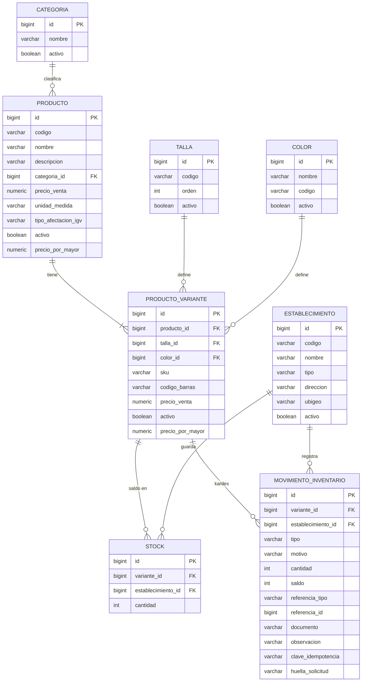
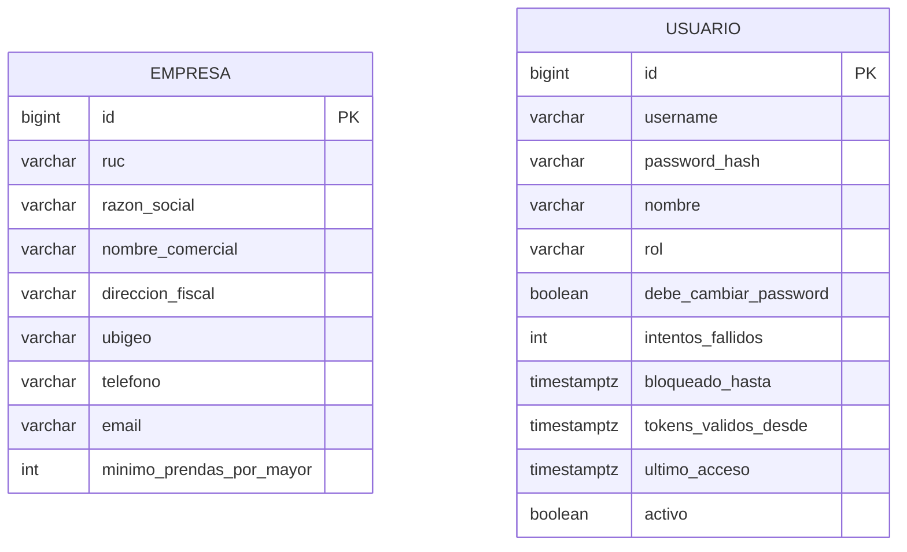

# Modelo de datos de AllStore

24 tablas y 33 llaves foráneas (versión de base de datos V19). Todas las tablas, salvo las
de líneas (`comprobante_detalle`, `comprobante_pago`, `guia_remision_detalle`, `resumen_sunat_detalle`), tienen además `created_at`, `updated_at`,
`created_by` y `updated_by` (auditoría), que no se repiten en los diagramas.

`empresa` y `usuario` no tienen llaves foráneas: hay una sola empresa (id = 1) y el usuario se
relaciona por su `username` en las columnas de auditoría y en `caja_sesion.usuario`.

El diccionario completo (cada columna con su tipo, reglas y descripción) se genera aparte en PDF.

## Catálogo e inventario

## Ventas, caja y SUNAT

## Bajas, guías de remisión y entrega al cliente

## Tablas sin llaves foráneas

