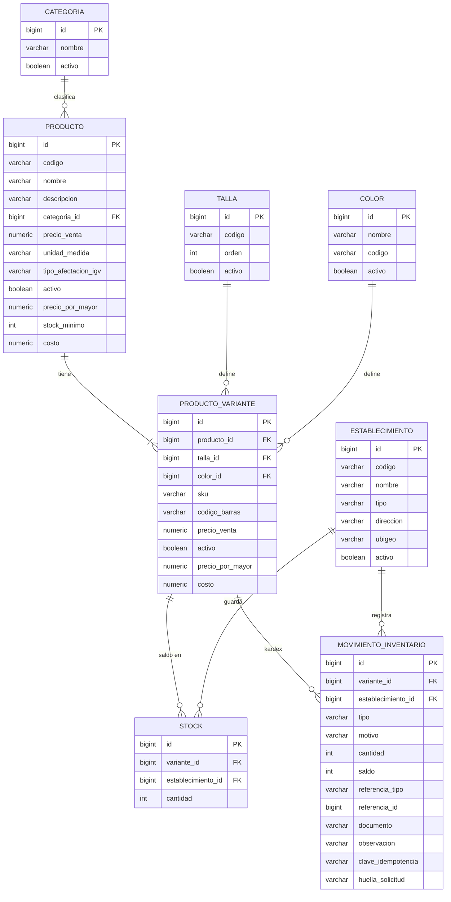
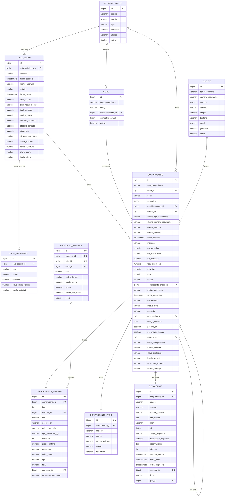
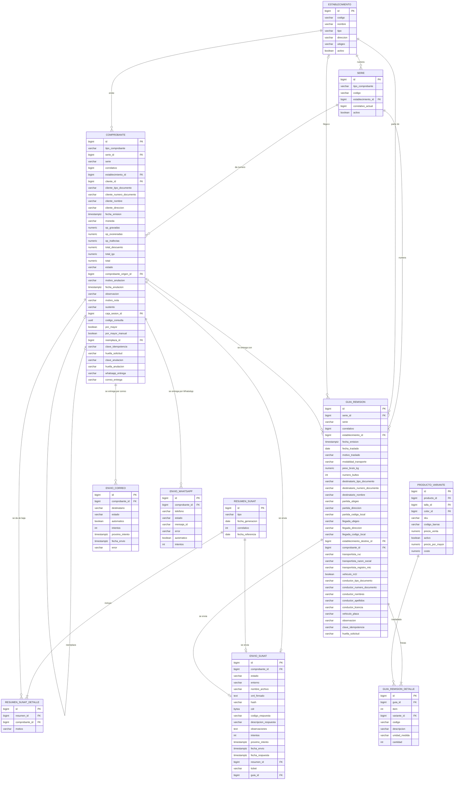
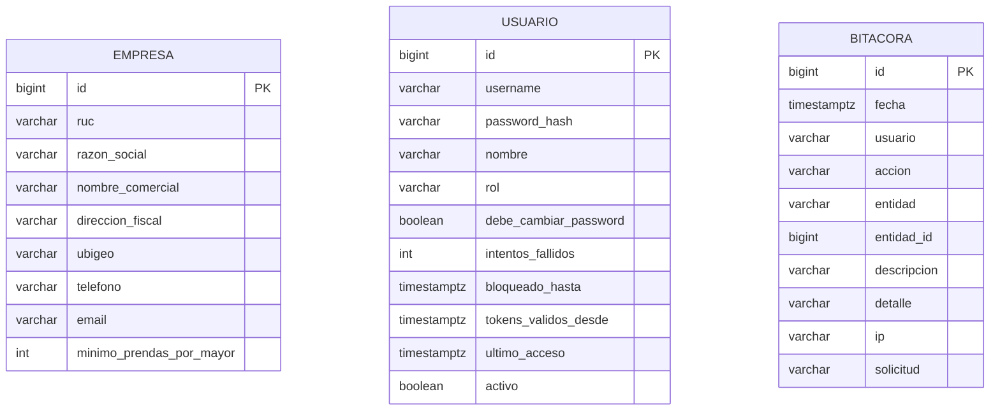

# Modelo de datos de AllStore

40 tablas y 62 llaves foráneas (versión de base de datos V25). Todas las tablas, salvo las
de líneas (`bitacora`, `campana_alcance`, `compra_detalle`, `comprobante_detalle`, `comprobante_pago`, `conteo_detalle`, `guia_remision_detalle`, `movimiento_insumo`, `orden_produccion_etapa`, `orden_produccion_insumo`, `orden_produccion_talla`, `resumen_sunat_detalle`), tienen además `created_at`, `updated_at`,
`created_by` y `updated_by` (auditoría), que no se repiten en los diagramas.

`empresa`, `usuario` y `bitacora` no tienen llaves foráneas: hay una sola empresa (id = 1), el usuario
se relaciona por su `username` en las columnas de auditoría y en `caja_sesion.usuario`, y la bitácora guarda
el usuario y el registro afectado como texto e id (sigue valiendo aunque el registro cambie).

El diccionario completo (cada columna con su tipo, reglas y descripción) se genera aparte en PDF.

## Catálogo e inventario

## Ventas, caja y SUNAT

## Bajas, guías de remisión y entrega al cliente

## Compras, insumos, producción, promociones y conteos

```mermaid
erDiagram
  PRODUCTO ||--|{ PRODUCTO_VARIANTE : "tiene"
  PRODUCTO_VARIANTE ||--o{ STOCK_MINIMO : "minimo en"
  ESTABLECIMIENTO ||--o{ STOCK_MINIMO : "exige"
  ESTABLECIMIENTO ||--o{ CONTEO_INVENTARIO : "se cuenta"
  CONTEO_INVENTARIO ||--|{ CONTEO_DETALLE : "prendas"
  PRODUCTO_VARIANTE ||--o{ CONTEO_DETALLE : "contada"
  ESTABLECIMIENTO |o--o{ CAMPANA : "aplica en"
  CAMPANA ||--o{ CAMPANA_ALCANCE : "aplica a"
  PRODUCTO |o--o{ CAMPANA_ALCANCE : "en promocion"
  PRODUCTO_VARIANTE |o--o{ CAMPANA_ALCANCE : "en promocion"
  INSUMO ||--o{ STOCK_INSUMO : "saldo en"
  ESTABLECIMIENTO ||--o{ STOCK_INSUMO : "guarda"
  INSUMO ||--o{ MOVIMIENTO_INSUMO : "kardex"
  ESTABLECIMIENTO ||--o{ MOVIMIENTO_INSUMO : "registra"
  PROVEEDOR ||--o{ COMPRA : "vende"
  ESTABLECIMIENTO ||--o{ COMPRA : "recibe"
  COMPRA ||--|{ COMPRA_DETALLE : "lineas"
  PRODUCTO_VARIANTE |o--o{ COMPRA_DETALLE : "comprada"
  INSUMO |o--o{ COMPRA_DETALLE : "comprado"
  PRODUCTO ||--o{ ORDEN_PRODUCCION : "se produce"
  ESTABLECIMIENTO ||--o{ ORDEN_PRODUCCION : "da insumos"
  ESTABLECIMIENTO ||--o{ ORDEN_PRODUCCION : "recibe"
  ORDEN_PRODUCCION ||--|{ ORDEN_PRODUCCION_TALLA : "tallas"
  PRODUCTO_VARIANTE ||--o{ ORDEN_PRODUCCION_TALLA : "producida"
  ORDEN_PRODUCCION ||--|{ ORDEN_PRODUCCION_ETAPA : "etapas"
  PROVEEDOR |o--o{ ORDEN_PRODUCCION_ETAPA : "taller"
  ORDEN_PRODUCCION ||--o{ ORDEN_PRODUCCION_INSUMO : "consume"
  INSUMO ||--o{ ORDEN_PRODUCCION_INSUMO : "consumido"
  PROVEEDOR {
    bigint id PK
    varchar tipo_documento
    varchar numero_documento
    varchar razon_social
    varchar direccion
    varchar telefono
    varchar email
    boolean activo
  }
  COMPRA {
    bigint id PK
    bigint proveedor_id FK
    bigint establecimiento_id FK
    varchar tipo_documento
    varchar serie
    varchar numero
    date fecha_emision
    varchar periodo
    numeric base_gravada
    numeric igv
    numeric no_gravado
    numeric total
    varchar estado
    varchar motivo_anulacion
    varchar observacion
  }
  COMPRA_DETALLE {
    bigint id PK
    bigint compra_id FK
    int item
    bigint variante_id FK
    bigint insumo_id FK
    varchar descripcion
    numeric cantidad
    numeric costo_unitario
    boolean gravado
    numeric valor
    numeric igv
    numeric total
  }
  INSUMO {
    bigint id PK
    varchar codigo
    varchar nombre
    varchar unidad_medida
    numeric costo
    boolean activo
  }
  STOCK_INSUMO {
    bigint id PK
    bigint insumo_id FK
    bigint establecimiento_id FK
    numeric cantidad
  }
  MOVIMIENTO_INSUMO {
    bigint id PK
    bigint insumo_id FK
    bigint establecimiento_id FK
    varchar tipo
    varchar motivo
    numeric cantidad
    numeric saldo
    varchar referencia_tipo
    bigint referencia_id
    varchar documento
    varchar observacion
    timestamptz fecha
    varchar usuario
  }
  ORDEN_PRODUCCION {
    bigint id PK
    bigint producto_id FK
    bigint establecimiento_insumos_id FK
    bigint establecimiento_destino_id FK
    varchar estado
    varchar observacion
    timestamptz fecha_fin
    int unidades_terminadas
    numeric costo_insumos
    numeric costo_servicios
    numeric costo_unitario
    varchar motivo_anulacion
  }
  ORDEN_PRODUCCION_TALLA {
    bigint id PK
    bigint orden_id FK
    bigint variante_id FK
    int cantidad_planificada
    int cantidad_terminada
  }
  ORDEN_PRODUCCION_ETAPA {
    bigint id PK
    bigint orden_id FK
    varchar etapa
    int orden_etapa
    varchar estado
    bigint proveedor_id FK
    timestamptz fecha_inicio
    timestamptz fecha_fin
    int unidades
    numeric costo_servicio
    varchar observacion
  }
  ORDEN_PRODUCCION_INSUMO {
    bigint id PK
    bigint orden_id FK
    bigint insumo_id FK
    numeric cantidad
  }
  PRODUCTO {
    bigint id PK
    varchar codigo
    varchar nombre
    varchar descripcion
    bigint categoria_id FK
    numeric precio_venta
    varchar unidad_medida
    varchar tipo_afectacion_igv
    boolean activo
    numeric precio_por_mayor
    int stock_minimo
    numeric costo
  }
  PRODUCTO_VARIANTE {
    bigint id PK
    bigint producto_id FK
    bigint talla_id FK
    bigint color_id FK
    varchar sku
    varchar codigo_barras
    numeric precio_venta
    boolean activo
    numeric precio_por_mayor
    numeric costo
  }
  ESTABLECIMIENTO {
    bigint id PK
    varchar codigo
    varchar nombre
    varchar tipo
    varchar direccion
    varchar ubigeo
    boolean activo
  }
  CAMPANA {
    bigint id PK
    varchar nombre
    varchar descripcion
    varchar tipo
    numeric valor
    date fecha_inicio
    date fecha_fin
    bigint establecimiento_id FK
    boolean activo
  }
  CAMPANA_ALCANCE {
    bigint id PK
    bigint campana_id FK
    bigint categoria_id FK
    bigint producto_id FK
    bigint variante_id FK
  }
  STOCK_MINIMO {
    bigint id PK
    bigint variante_id FK
    bigint establecimiento_id FK
    int minimo
  }
  CONTEO_INVENTARIO {
    bigint id PK
    bigint establecimiento_id FK
    varchar estado
    varchar alcance
    varchar observacion
    timestamptz fecha_cierre
    int unidades_sobrantes
    int unidades_faltantes
  }
  CONTEO_DETALLE {
    bigint id PK
    bigint conteo_id FK
    bigint variante_id FK
    int stock_inicial
    int contado
    int stock_al_contar
    timestamptz fecha_conteo
    int ajuste
  }
```

## Tablas sin llaves foráneas

