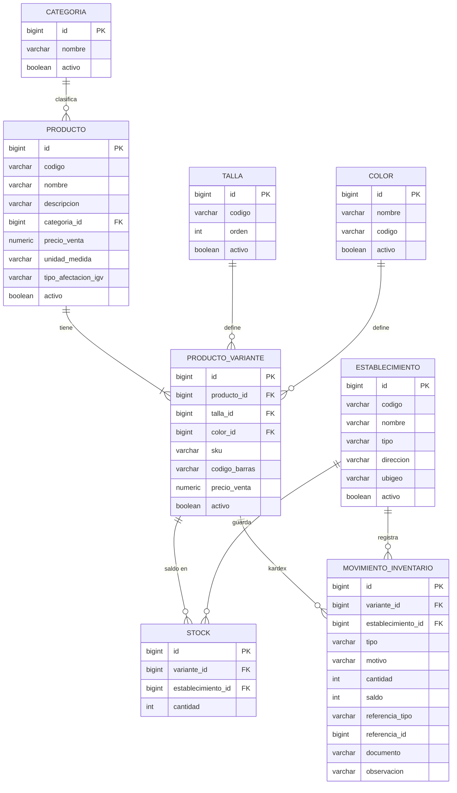
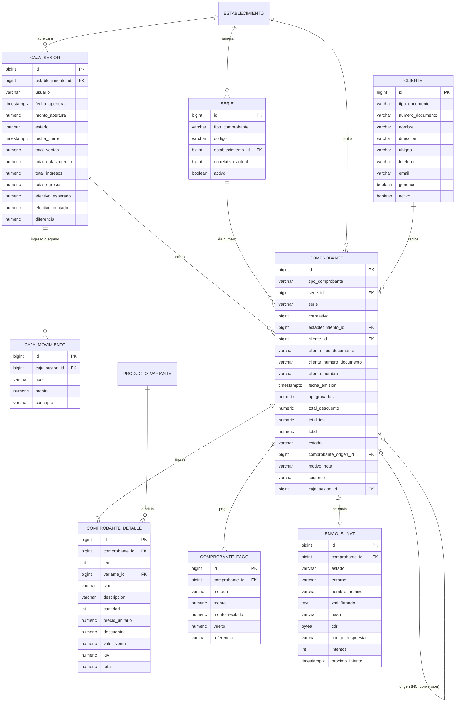
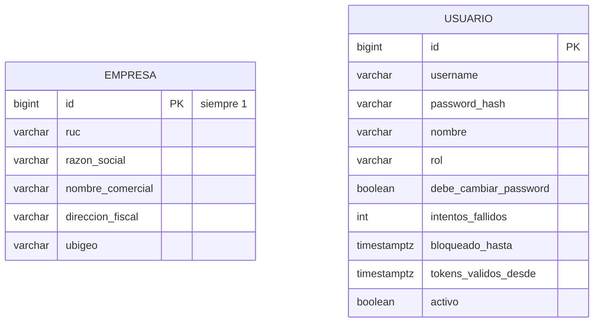

# Modelo de datos de AllStore

18 tablas y 20 llaves foráneas (versión de base de datos V8). Todas las tablas, salvo
`comprobante_detalle` y `comprobante_pago`, tienen además `created_at`, `updated_at`,
`created_by` y `updated_by` (auditoría), que no se repiten en el diagrama.

`empresa` y `usuario` no tienen llaves foráneas: hay una sola empresa (id = 1) y el usuario se
relaciona por su `username` en las columnas de auditoría y en `caja_sesion.usuario`.

## Catálogo e inventario

## Ventas, caja y SUNAT

## Tablas sin llaves foráneas

